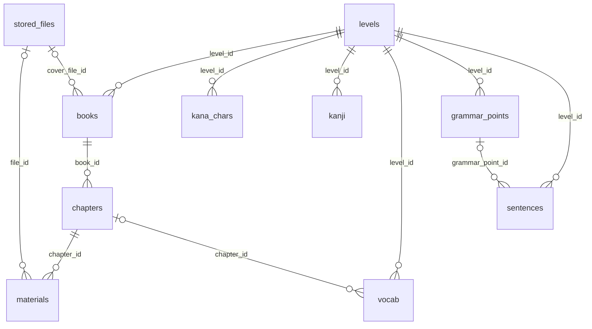
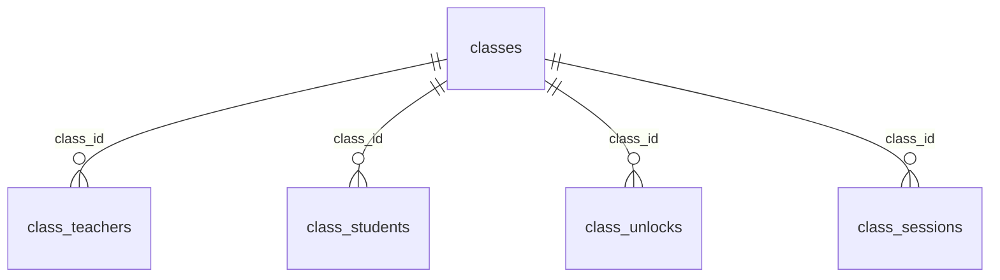
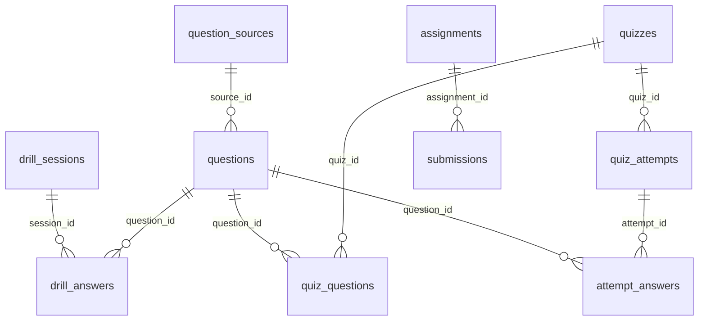
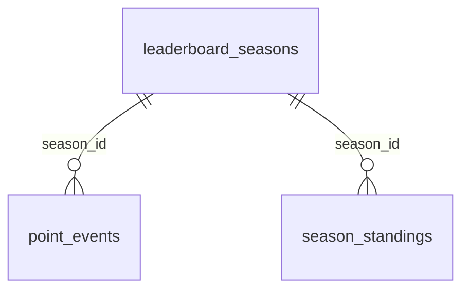

# 03 · Skema Data (Kontrak)

> Dokumen ini adalah **kontrak data**. AI dan developer hanya boleh membuat tabel dan kolom yang tertulis di sini, dengan nama, tipe, dan constraint yang sama. Perubahan mengikuti protokol `AGENTS.md` §5.4: usulkan → disetujui → ubah dokumen ini → migrasi → kode → tes.
>
> Dasar: v1 §6 (skema data). Penanda ➕ = tambahan v2, ✏️ = diubah dari v1.

## 1. Aturan global

1. **Penamaan**: snake_case. Nama tabel jamak sesuai daftar di dokumen ini. Nama kolom persis seperti tertulis.
2. **Schema per modul**: `identity`, `content`, `classroom`, `practice`, `insight`.
3. **Primary key**: `id uuid`, nilai **UUIDv7 dibuat aplikasi** (`Guid.CreateVersion7()`), kecuali `identity.user_profiles.id` yang sama dengan `sub` Keycloak. Tabel relasi memakai PK gabungan seperti tertulis.
4. **Audit waktu**: setiap tabel punya `created_at timestamptz not null default now()` dan `updated_at timestamptz not null default now()`, diisi otomatis oleh interceptor EF. Kolom ini **tidak ditulis ulang** di tabel-tabel di bawah. Pengecualian: tabel infrastruktur (§10).
5. **Waktu**: selalu `timestamptz` dan disimpan dalam UTC. Konversi ke zona waktu pengguna hanya di tampilan.
6. **Enum**: kolom `text` + CHECK constraint, nilai snake_case huruf kecil persis seperti §3.3 (D-08). Di C# memakai enum + converter snake_case.
7. **TextBlock dan RichText** disimpan sebagai `jsonb` (§3). Kunci JSON di dalam jsonb memakai camelCase, sama dengan API.
8. **Persen, poin, bobot**: `numeric` (bukan float). Di C# memakai `decimal`.
9. **Array**: `text[]` untuk tag, `uuid[]` untuk daftar id.
10. **Referensi lintas modul**: kolom `uuid` biasa **tanpa foreign key** (§12). Validasi lewat interface Contracts.
11. **Penghapusan**: hard delete hanya untuk data tanpa dependen. Selain itu memakai status (`archived`, `removed`, `is_active`, dst.).
12. **Concurrency**: entitas yang bisa diedit bersamaan (konten, soal, kuis, tugas, skema nilai) memakai `xmin` sebagai concurrency token. Konflik menghasilkan 409 `concurrency_conflict`.
13. **Kolom teks bebas** (`text`) tetap punya batas panjang di validasi aplikasi (lihat kolom keterangan).
14. **Teks operasional vs konten**: teks yang ditulis staf untuk operasional (nama kelas, topik pertemuan, catatan, komentar, feedback) memakai `varchar`/`text` biasa. Teks konten pembelajaran memakai TextBlock/RichText.

## 2. Perubahan dari v1

| Perubahan | Tabel/kolom | Alasan |
|---|---|---|
| ✏️ `order` → `sort_order` | levels, books, chapters, quiz_questions | `order` adalah kata kunci SQL |
| ✏️ `item_ref` → `item_type` + `item_id` | questions | Selaras dengan `item_masteries(item_type, item_id)` dan bisa diindeks |
| ✏️ `chapter_id` wajib | questions | Gating bab harus ketat (BR-AKSES-01) |
| ✏️ `chapter_id` opsional | quizzes, assignments | Ujian bisa lintas bab |
| ✏️ `class_id` opsional | drill_sessions | Drilling bisa memakai gabungan bab dari beberapa kelas |
| ➕ `username`, `email` | user_profiles | Salinan dari Keycloak untuk daftar admin dan email pengingat |
| ➕ `purpose` | stored_files | Housekeeping dan otorisasi unduhan |
| ➕ `sort_order` | materials | Urutan materi dalam bab |
| ➕ kolom isi | kana_chars, kanji, vocab, grammar_points, sentences | v1 hanya menyebut level_id, chapter_id, source, license |
| ➕ `status`, `sequence` | class_sessions | Pembatalan dan versi event ICS |
| ➕ `status`, `attempts`, `dedupe_key`, `last_error` | notifications | Antrean pengiriman yang andal |
| ➕ tabel `push_subscriptions` | classroom | Web push butuh endpoint dan kunci per perangkat |
| ➕ `scope`, status `archived` | questions | Bank bawaan vs soal pribadi; soal yang sudah dipakai tidak diubah |
| ➕ `level_id`, `chapter_id`, `category`, `tags` | item_masteries | Agregasi kelemahan tanpa join lintas modul |
| ➕ `status`, `created_by` | quizzes, assignments | Draf sebelum terbit |
| ➕ `attempt_no`, `expires_at`, `question_order` | quiz_attempts | Batas percobaan, timer di server, urutan acak yang stabil |
| ➕ `graded_by`, `graded_at` | attempt_answers | Penilaian manual jawaban esai |
| ➕ `breakdown` | class_grades | Transparansi nilai per komponen |
| ➕ `closed_by` | leaderboard_seasons | Audit |
| ➕ `rule` | point_events | Jejak aturan anti-farming yang diterapkan |
| ➕ tabel `season_standings` | insight | Arsip peringkat akhir season |
| ➕ tabel `outbox_messages`, `inbox_messages` | tiap schema | Event antar-modul yang andal (D-03) |

## 3. Tipe bersama

### 3.1 TextBlock (teks konten dengan pendamping Jepang)

```ts
type JaSegment = {
  t: string;   // teks Jepang apa adanya (kanji/kana/tanda baca). Segmen " " (satu spasi ASCII) = batas kata untuk romaji, tidak dirender
  r?: string;  // bacaan/furigana (hiragana atau katakana). Hanya bila t memuat kanji
  ro?: string; // override romaji, terutama partikel: は→"wa", を→"o", へ→"e"
  v?: string;  // uuid content.vocab untuk fitur "ketuk untuk melihat arti" (opsional)
};
type TextBlock = { id?: string; en?: string; ja?: JaSegment[] };
```

Contoh (dari v1):

```json
{
  "id": "Saya belajar bahasa Jepang.",
  "en": "I study Japanese.",
  "ja": [
    {"t": "私", "r": "わたし"}, {"t": "は", "ro": "wa"},
    {"t": "日本語", "r": "にほんご"}, {"t": "を", "ro": "o"},
    {"t": "勉強", "r": "べんきょう"}, {"t": "します"}
  ]
}
```

Aturan validasi per pemakaian:

| Pemakaian | `id` | `en` | `ja` |
|---|---|---|---|
| Label UI (frontend, [06](06-teks-multibahasa.md) §6) | wajib | wajib | wajib |
| Judul/nama konten: `levels.name`, `books.title`, `chapters.title`, `materials.title`, `grammar_points.title`, `quizzes.title`, `assignments.title` | wajib | opsional | opsional |
| `questions.prompt` (instruksi soal) | wajib | opsional | opsional |
| Stimulus, pilihan, token, kartu di payload soal | minimal salah satu dari `id`/`ja` | opsional | – |
| `sentences.text` | wajib | opsional | wajib |

Batas: `id`/`en` ≤ 2.000 karakter; `ja` ≤ 500 segmen; `t` dan `r` ≤ 100 karakter; `ro` hanya huruf kecil a–z, apostrof, tanda hubung, dan spasi.

### 3.2 RichText (bacaan/materi panjang)

```ts
type RichText = { format: "md"; id: string; en?: string };
```

- Markdown terbatas: paragraf, heading `##`/`###`, tebal, miring (tidak untuk teks Jepang), daftar, tabel, kutipan, tautan `https`.
- Teks Jepang di dalamnya memakai markup furigana `{漢字|かんじ}` ([06](06-teks-multibahasa.md) §3), sehingga ikut preferensi tampilan pengguna.
- Dilarang: HTML mentah, gambar inline (unggah sebagai materi file), skrip.
- Maksimal 50.000 karakter per bahasa.

### 3.3 Enum

| Enum | Dipakai di | Nilai valid |
|---|---|---|
| role | `user_profiles.role` | `admin`, `sensei`, `murid` |
| ui_locale | `user_profiles.ui_locale` | `id`, `en` |
| script_pref | `user_profiles.script_pref` | `off`, `kanji_furigana`, `kana`, `romaji`, `kanji_furigana_romaji` |
| material_kind | `materials.kind` | `file`, `link`, `richtext` |
| file_status | `stored_files.status` | `uploading`, `ready`, `failed`, `deleted` |
| file_purpose | `stored_files.purpose` | `material`, `book_cover`, `submission`, `question_import` |
| kana_script | `kana_chars.script` | `hiragana`, `katakana` |
| kana_variant | `kana_chars.variant` | `seion`, `dakuon`, `handakuon`, `youon` |
| class_status | `classes.status` | `draft`, `active`, `archived` |
| member_status | `class_students.status` | `active`, `removed` |
| session_platform | `class_sessions.platform` | `zoom`, `discord`, `other` |
| session_status | `class_sessions.status` | `scheduled`, `cancelled` |
| notification_channel | `notifications.channel` | `email`, `web_push` |
| notification_status | `notifications.status` | `pending`, `sent`, `failed`, `cancelled` |
| question_kind | `questions.kind` | `mcq`, `tap_sentence`, `type_answer`, `match`, `flashcard`, `handwrite_kana`, `handwrite_kanji`, `long_answer` |
| category | `questions.category`, `drill_sessions.category`, `item_masteries.category` | `hiragana`, `katakana`, `kanji`, `vocab`, `grammar`, `sentence` |
| question_status | `questions.status` | `draft`, `review`, `published`, `archived` |
| question_scope | `questions.scope` | `builtin`, `private` |
| ref_item_type | `questions.item_type` | `kana`, `kanji`, `vocab`, `grammar`, `sentence` |
| mastery_item_type | `item_masteries.item_type` | `kana`, `kanji`, `vocab`, `grammar`, `sentence`, `question` |
| input_mode | `drill_answers.input_mode` | `choice`, `tap`, `type`, `handwrite`, `self_check` |
| quiz_kind | `quizzes.kind` | `quiz`, `exam` |
| publish_status | `quizzes.status`, `assignments.status` | `draft`, `published`, `archived` |
| attempt_status | `quiz_attempts.status` | `in_progress`, `submitted`, `graded` |
| comment_target | `comments.target_type` | `drill_session`, `quiz_attempt`, `submission`, `progress` |
| season_status | `leaderboard_seasons.status` | `active`, `closed` |
| point_source | `point_events.source_type` | `drill`, `quiz`, `exam` |
| ja_display | payload soal `jaDisplay` | `user_pref`, `plain`, `no_romaji` |

## 4. Modul Identity — schema `identity`

### 4.1 `identity.user_profiles`

| Kolom | Tipe | Null | Default | Keterangan |
|---|---|---|---|---|
| `id` | uuid | PK | – | = `sub` Keycloak (bukan UUIDv7) |
| `username` ➕ | varchar(64) | tidak | – | salinan dari Keycloak |
| `email` ➕ | varchar(254) | ya | – | salinan dari Keycloak; untuk email pengingat |
| `display_name` | varchar(80) | tidak | – | tampil di leaderboard; diubah admin (D-21) |
| `role` | text | tidak | – | enum `role`; sinkron dengan realm role |
| `ui_locale` | text | tidak | `'id'` | enum `ui_locale` |
| `script_pref` | text | tidak | `'kanji_furigana'` | enum `script_pref` |
| `timezone` | varchar(64) | tidak | `'Asia/Jakarta'` | nama zona IANA, divalidasi |
| `is_active` | boolean | tidak | `true` | |
| `created_by` | uuid | ya | – | admin pembuat; null untuk akun seed |

Index: unique `(username)`; unique `(lower(email)) where email is not null`; `(role, is_active)`.

## 5. Modul Content — schema `content`

### 5.1 `content.levels`

| Kolom | Tipe | Null | Keterangan |
|---|---|---|---|
| `id` | uuid | PK | |
| `code` | varchar(16) | tidak | unik: `dasar`, `n5`, `n4`, `n3` |
| `name` | jsonb (TextBlock) | tidak | |
| `sort_order` ✏️ | int | tidak | v1: `order` |

### 5.2 `content.books`

| Kolom | Tipe | Null | Keterangan |
|---|---|---|---|
| `id` | uuid | PK | |
| `level_id` | uuid | tidak | FK → `levels.id` |
| `title` | jsonb (TextBlock) | tidak | |
| `cover_file_id` | uuid | ya | FK → `stored_files.id` (purpose `book_cover`) |
| `sort_order` ✏️ | int | tidak | |

Index: `(level_id, sort_order)`.

### 5.3 `content.chapters`

| Kolom | Tipe | Null | Keterangan |
|---|---|---|---|
| `id` | uuid | PK | |
| `book_id` | uuid | tidak | FK → `books.id` |
| `number` | int | tidak | nomor bab yang tampil; unik per buku |
| `title` | jsonb (TextBlock) | tidak | |
| `sort_order` ✏️ | int | tidak | |

Index: unique `(book_id, number)`; `(book_id, sort_order)`.

### 5.4 `content.materials`

| Kolom | Tipe | Null | Keterangan |
|---|---|---|---|
| `id` | uuid | PK | |
| `chapter_id` | uuid | tidak | FK → `chapters.id` |
| `kind` | text | tidak | enum `material_kind` |
| `title` | jsonb (TextBlock) | tidak | |
| `body` | jsonb (RichText) | ya | wajib bila `kind = 'richtext'` |
| `file_id` | uuid | ya | FK → `stored_files.id`; wajib bila `kind = 'file'` |
| `url` | varchar(2048) | ya | wajib bila `kind = 'link'`; hanya `https://` |
| `publish_at` | timestamptz | ya | null = tampil segera; waktu mendatang = disembunyikan dari murid sampai waktunya |
| `created_by` | uuid | tidak | sensei/admin pembuat |
| `sort_order` ➕ | int | tidak | default 0; urutan dalam bab |

CHECK: `(kind = 'file' and file_id is not null) or (kind = 'link' and url is not null) or (kind = 'richtext' and body is not null)`.
Index: `(chapter_id, sort_order)`.

### 5.5 `content.stored_files`

| Kolom | Tipe | Null | Keterangan |
|---|---|---|---|
| `id` | uuid | PK | juga dipakai sebagai id upload tus |
| `storage_key` | varchar(512) | tidak | unik; path/key acak di storage, bukan nama asli |
| `original_name` | varchar(255) | tidak | disanitasi saat ditampilkan/diunduh |
| `mime` | varchar(255) | tidak | dari klien; **tidak dipercaya** untuk rendering |
| `size_bytes` | bigint | tidak | CHECK `size_bytes between 0 and 1073741824` (1 GiB) |
| `sha256` | char(64) | ya | diisi setelah upload selesai |
| `uploaded_by` | uuid | tidak | |
| `status` | text | tidak | enum `file_status`; default `'uploading'` |
| `purpose` ➕ | text | tidak | enum `file_purpose` |

Index: `(uploaded_by)`; `(status, created_at)` untuk pembersihan.

### 5.6 Data referensi

Semua tabel data referensi punya kolom bersama v1: `level_id uuid not null` (FK → `levels`), `chapter_id uuid null` (FK → `chapters`), `source varchar(200) not null`, `license varchar(100) not null`. Index bersama: `(level_id, chapter_id)`. Item tanpa `chapter_id` belum dipakai generator soal (BR-KONTEN-04).

**`content.kana_chars`** ➕ kolom isi

| Kolom | Tipe | Null | Keterangan |
|---|---|---|---|
| `id` | uuid | PK | |
| `char` | varchar(4) | tidak | mis. `か`, `きゃ` |
| `script` | text | tidak | enum `kana_script` |
| `romaji` | varchar(8) | tidak | mis. `ka`, `kya` |
| `row_key` | varchar(8) | tidak | baris: `a`, `ka`, `sa`, …, `n`, `ga`, `za`, `da`, `ba`, `pa`, `kya`, `sha`, … (dipakai agregasi "baris kana") |
| `variant` | text | tidak | enum `kana_variant` |
| `sort_order` | int | tidak | |

Unique: `(script, char)`.

**`content.kanji`** ➕ kolom isi

| Kolom | Tipe | Null | Keterangan |
|---|---|---|---|
| `id` | uuid | PK | |
| `character` | varchar(4) | tidak | unik |
| `onyomi` | text[] | tidak | katakana; default `{}` |
| `kunyomi` | text[] | tidak | hiragana; okurigana dipisah titik, mis. `た.べる`; default `{}` |
| `meanings` | jsonb | tidak | `{"id": ["makan"], "en": ["eat"]}` |
| `stroke_count` | smallint | ya | |
| `kanjivg_code` | varchar(8) | ya | kode heksadesimal file KanjiVG, mis. `098df` |

**`content.vocab`** ➕ kolom isi

| Kolom | Tipe | Null | Keterangan |
|---|---|---|---|
| `id` | uuid | PK | |
| `word` | varchar(100) | tidak | bentuk tulis (kanji/kana) |
| `reading` | varchar(100) | tidak | kana |
| `meanings` | jsonb | tidak | `{"id": [...], "en": [...]}` |
| `pos` | varchar(32) | ya | kelas kata: `noun`, `verb_godan`, `verb_ichidan`, `verb_irregular`, `adj_i`, `adj_na`, `adverb`, `particle`, `counter`, `expression` |
| `tags` | text[] | tidak | default `{}` |
| `jmdict_seq` | bigint | ya | nomor entri JMdict bila bersumber dari JMdict |

Unique: `(level_id, word, reading)`.

**`content.grammar_points`** ➕ kolom isi

| Kolom | Tipe | Null | Keterangan |
|---|---|---|---|
| `id` | uuid | PK | |
| `pattern` | varchar(100) | tidak | mis. `〜は〜です` |
| `title` | jsonb (TextBlock) | tidak | |
| `explanation` | jsonb (RichText) | ya | |
| `tags` | text[] | tidak | default `{}`; mis. `particle:wa` (dipakai agregasi "jenis partikel") |

**`content.sentences`** ➕ kolom isi

| Kolom | Tipe | Null | Keterangan |
|---|---|---|---|
| `id` | uuid | PK | |
| `text` | jsonb (TextBlock) | tidak | wajib `id` dan `ja` |
| `tags` | text[] | tidak | default `{}` |
| `grammar_point_id` | uuid | ya | FK → `grammar_points.id` |
| `tatoeba_id` | bigint | ya | bila bersumber dari Tatoeba |

### 5.7 ERD Content



## 6. Modul Classroom — schema `classroom`

### 6.1 `classroom.classes`

| Kolom | Tipe | Null | Keterangan |
|---|---|---|---|
| `id` | uuid | PK | |
| `level_id` | uuid | tidak | ref `content.levels` (tanpa FK) |
| `book_id` | uuid | tidak | ref `content.books`; buku harus milik level yang sama |
| `name` | varchar(100) | tidak | mis. "N5 Sabtu Pagi" (teks operasional) |
| `status` | text | tidak | enum `class_status`; default `'active'` |
| `created_by` | uuid | tidak | |

Index: `(status)`; `(level_id)`.

### 6.2 `classroom.class_teachers`

| Kolom | Tipe | Null | Keterangan |
|---|---|---|---|
| `class_id` | uuid | PK (1/2) | FK → `classes.id` |
| `teacher_id` | uuid | PK (2/2) | ref `identity.user_profiles` (peran sensei/admin) |
| `is_primary` | boolean | tidak | default `false` |

Index: unique `(class_id) where is_primary` (satu pengajar utama per kelas); `(teacher_id)`.

### 6.3 `classroom.class_students`

| Kolom | Tipe | Null | Keterangan |
|---|---|---|---|
| `class_id` | uuid | PK (1/2) | FK → `classes.id` |
| `student_id` | uuid | PK (2/2) | ref `identity.user_profiles` (peran murid) |
| `joined_at` | timestamptz | tidak | default `now()` |
| `status` | text | tidak | enum `member_status`; default `'active'` |

Index: `(student_id, status)`.

### 6.4 `classroom.class_unlocks`

| Kolom | Tipe | Null | Keterangan |
|---|---|---|---|
| `class_id` | uuid | PK (1/2) | FK → `classes.id` |
| `chapter_id` | uuid | PK (2/2) | ref `content.chapters`; harus milik buku kelas |
| `unlocked_by` | uuid | tidak | |
| `unlocked_at` | timestamptz | tidak | |

Menutup bab = menghapus baris (riwayat tercatat lewat event dan log aktivitas).

### 6.5 `classroom.class_sessions`

| Kolom | Tipe | Null | Keterangan |
|---|---|---|---|
| `id` | uuid | PK | |
| `class_id` | uuid | tidak | FK → `classes.id` |
| `chapter_id` | uuid | ya | ref `content.chapters` |
| `topic` | varchar(200) | tidak | teks operasional |
| `starts_at` | timestamptz | tidak | |
| `ends_at` | timestamptz | tidak | CHECK `ends_at > starts_at` |
| `timezone` | varchar(64) | tidak | zona waktu pembuat, untuk tampilan |
| `platform` | text | tidak | enum `session_platform` |
| `meeting_url` | varchar(2048) | ya | hanya `https://`; hanya terlihat anggota kelas (BR-JADWAL-02) |
| `note` | text | ya | ≤ 2.000 karakter |
| `status` ➕ | text | tidak | enum `session_status`; default `'scheduled'` |
| `sequence` ➕ | int | tidak | default 0; naik setiap perubahan (SEQUENCE di ICS) |

Index: `(class_id, starts_at)`; `(starts_at) where status = 'scheduled'`.

### 6.6 `classroom.calendar_feed_tokens`

| Kolom | Tipe | Null | Keterangan |
|---|---|---|---|
| `user_id` | uuid | PK | satu token aktif per pengguna |
| `token_hash` | char(64) | tidak | unik; SHA-256 (hex) dari token. Token asli hanya ditampilkan sekali |

### 6.7 `classroom.notifications`

| Kolom | Tipe | Null | Keterangan |
|---|---|---|---|
| `id` | uuid | PK | |
| `user_id` | uuid | tidak | penerima |
| `type` | varchar(50) | tidak | katalog di [05](05-api-dan-event.md) §10 |
| `payload` | jsonb | tidak | data untuk template |
| `channel` | text | tidak | enum `notification_channel` |
| `send_at` | timestamptz | tidak | jadwal kirim |
| `sent_at` | timestamptz | ya | |
| `status` ➕ | text | tidak | enum `notification_status`; default `'pending'` |
| `attempts` ➕ | int | tidak | default 0 |
| `dedupe_key` ➕ | varchar(200) | tidak | unik; mis. `session:{id}:reminder_1d:{user}:{channel}` |
| `last_error` ➕ | text | ya | |

Index: `(send_at) where status = 'pending'`; `(user_id, created_at desc)`.

### 6.8 `classroom.push_subscriptions` ➕

| Kolom | Tipe | Null | Keterangan |
|---|---|---|---|
| `id` | uuid | PK | |
| `user_id` | uuid | tidak | |
| `endpoint` | text | tidak | unik; URL push service browser |
| `p256dh` | varchar(200) | tidak | kunci publik klien |
| `auth` | varchar(100) | tidak | secret klien |
| `user_agent` | varchar(300) | ya | untuk ditampilkan di daftar perangkat |
| `last_success_at` | timestamptz | ya | dihapus otomatis bila push service membalas 404/410 |

### 6.9 `classroom.google_calendar_links` (Fase 5, opsional)

| Kolom | Tipe | Null | Keterangan |
|---|---|---|---|
| `user_id` | uuid | PK | |
| `refresh_token_enc` | text | tidak | refresh token **terenkripsi** (ASP.NET Data Protection), base64 |

### 6.10 ERD Classroom



## 7. Modul Practice — schema `practice`

### 7.1 `practice.question_sources`

| Kolom | Tipe | Null | Keterangan |
|---|---|---|---|
| `id` | uuid | PK | |
| `name` | varchar(200) | tidak | mis. "Internal NomaX", "JMdict (EDRDG)" |
| `url` | varchar(2048) | ya | |
| `license` | varchar(100) | tidak | mis. `internal`, `CC BY-SA 4.0` |
| `imported_file_id` | uuid | ya | ref `content.stored_files` (purpose `question_import`) |
| `reviewed_by` | uuid | ya | |
| `reviewed_at` | timestamptz | ya | |

Seed wajib: satu sumber "Internal NomaX" dengan license `internal` untuk soal buatan sensei/admin.

### 7.2 `practice.questions`

| Kolom | Tipe | Null | Keterangan |
|---|---|---|---|
| `id` | uuid | PK | |
| `kind` | text | tidak | enum `question_kind` |
| `level_id` | uuid | tidak | ref `content.levels` |
| `chapter_id` ✏️ | uuid | tidak | ref `content.chapters`; wajib agar gating bab ketat |
| `category` | text | tidak | enum `category` |
| `tags` | text[] | tidak | default `{}`; mis. `kana_row:ka`, `particle:wa` |
| `prompt` | jsonb (TextBlock) | tidak | instruksi soal |
| `payload` | jsonb | tidak | isi soal per `kind` (§8); berisi kunci jawaban, **tidak pernah dikirim ke murid apa adanya** |
| `explanation` | jsonb (RichText) | ya | pembahasan |
| `item_type` ✏️ | text | ya | enum `ref_item_type`; v1: `item_ref` |
| `item_id` ✏️ | uuid | ya | ref item data referensi di `content`; v1: `item_ref` |
| `status` | text | tidak | enum `question_status`; default `'draft'` |
| `scope` ➕ | text | tidak | enum `question_scope`; default `'private'` |
| `source_id` | uuid | tidak | FK → `question_sources.id` |
| `owner_id` | uuid | tidak | pembuat (sensei/admin) |

CHECK: `(item_type is null) = (item_id is null)`.
Index: `(level_id, chapter_id, category, status)`; GIN `(tags)`; `(owner_id, status)`; `(item_type, item_id)`.

### 7.3 `practice.drill_sessions`

| Kolom | Tipe | Null | Keterangan |
|---|---|---|---|
| `id` | uuid | PK | |
| `student_id` | uuid | tidak | |
| `class_id` ✏️ | uuid | ya | konteks kelas (opsional) |
| `category` | text | tidak | enum `category` |
| `config` | jsonb | tidak | `{"chapterIds": [...], "mode": "normal" \| "weak_focus", "inputMode": "choice" \| "type" \| "handwrite"}` |
| `started_at` | timestamptz | tidak | |
| `ended_at` | timestamptz | ya | null = masih berjalan |

Index: `(student_id, started_at desc)`.

### 7.4 `practice.drill_answers`

| Kolom | Tipe | Null | Keterangan |
|---|---|---|---|
| `id` | uuid | PK | **dibuat klien** (UUIDv7) agar pengiriman ulang idempoten (BR-DRILL-07) |
| `session_id` | uuid | tidak | FK → `drill_sessions.id` |
| `question_id` | uuid | tidak | FK → `questions.id` |
| `input_mode` | text | tidak | enum `input_mode` |
| `answer` | jsonb | tidak | bentuk jawaban §8.2 |
| `is_correct` | boolean | tidak | dievaluasi server |
| `response_ms` | int | ya | CHECK `>= 0` |

Waktu jawab memakai `created_at` (waktu server). Index: `(session_id)`; `(question_id)`.

### 7.5 `practice.item_masteries`

| Kolom | Tipe | Null | Keterangan |
|---|---|---|---|
| `student_id` | uuid | PK (1/3) | |
| `item_type` | text | PK (2/3) | enum `mastery_item_type`; `question` dipakai bila soal tidak punya item referensi |
| `item_id` | uuid | PK (3/3) | id item referensi, atau id soal bila `item_type = 'question'` |
| `attempts` | int | tidak | default 0 |
| `correct` | int | tidak | default 0 |
| `streak` | int | tidak | default 0; benar berturut-turut |
| `last_seen_at` | timestamptz | tidak | |
| `mastery` | numeric(4,3) | tidak | default 0; CHECK `0..1`; rumus BR-MASTERY-01 |
| `level_id` ➕ | uuid | tidak | dimensi agregasi (salinan dari soal) |
| `chapter_id` ➕ | uuid | tidak | dimensi agregasi |
| `category` ➕ | text | tidak | enum `category` |
| `tags` ➕ | text[] | tidak | default `{}` |

Index: `(student_id, mastery)`; `(student_id, chapter_id)`; GIN `(tags)`.

### 7.6 `practice.quizzes`

| Kolom | Tipe | Null | Keterangan |
|---|---|---|---|
| `id` | uuid | PK | |
| `class_id` | uuid | tidak | ref `classroom.classes` |
| `chapter_id` ✏️ | uuid | ya | null = lintas bab (umumnya ujian) |
| `kind` | text | tidak | enum `quiz_kind` |
| `title` | jsonb (TextBlock) | tidak | |
| `time_limit_min` | int | ya | null = tanpa batas; CHECK `> 0` |
| `max_attempts` | int | tidak | default 1; CHECK `>= 1` |
| `open_at` | timestamptz | ya | null = langsung terbuka saat terbit |
| `close_at` | timestamptz | ya | null = tanpa batas tutup; CHECK `close_at > open_at` |
| `shuffle` | boolean | tidak | default `true` |
| `show_review` | boolean | tidak | default `false`; aturan BR-KUIS-09 |
| `status` ➕ | text | tidak | enum `publish_status`; default `'draft'` |
| `created_by` ➕ | uuid | tidak | |

Index: `(class_id, status, open_at)`.

### 7.7 `practice.quiz_questions`

| Kolom | Tipe | Null | Keterangan |
|---|---|---|---|
| `quiz_id` | uuid | PK (1/2) | FK → `quizzes.id` |
| `question_id` | uuid | PK (2/2) | FK → `questions.id`; soal harus `published` |
| `points` | numeric(6,2) | tidak | default 1; CHECK `> 0` |
| `sort_order` ✏️ | int | tidak | v1: `order` |

### 7.8 `practice.quiz_attempts`

| Kolom | Tipe | Null | Keterangan |
|---|---|---|---|
| `id` | uuid | PK | |
| `quiz_id` | uuid | tidak | FK → `quizzes.id` |
| `student_id` | uuid | tidak | |
| `attempt_no` ➕ | int | tidak | 1, 2, …; ≤ `max_attempts` |
| `started_at` | timestamptz | tidak | |
| `expires_at` ➕ | timestamptz | ya | `min(started_at + time_limit, close_at)`; null bila tanpa batas |
| `submitted_at` | timestamptz | ya | |
| `score_pct` | numeric(5,2) | ya | CHECK `0..100`; terisi saat `graded` |
| `status` | text | tidak | enum `attempt_status` |
| `question_order` ➕ | uuid[] | tidak | urutan soal untuk attempt ini (hasil acak), stabil saat halaman dimuat ulang |

Index: unique `(quiz_id, student_id, attempt_no)`; unique `(quiz_id, student_id) where status = 'in_progress'`; `(student_id, status)`.

### 7.9 `practice.attempt_answers`

| Kolom | Tipe | Null | Keterangan |
|---|---|---|---|
| `attempt_id` | uuid | PK (1/2) | FK → `quiz_attempts.id` |
| `question_id` | uuid | PK (2/2) | FK → `questions.id` |
| `answer` | jsonb | ya | null = belum dijawab |
| `is_correct` | boolean | ya | null = menunggu penilaian manual |
| `points` | numeric(6,2) | ya | |
| `graded_by` ➕ | uuid | ya | untuk `long_answer` |
| `graded_at` ➕ | timestamptz | ya | |

### 7.10 `practice.assignments`

| Kolom | Tipe | Null | Keterangan |
|---|---|---|---|
| `id` | uuid | PK | |
| `class_id` | uuid | tidak | ref `classroom.classes` |
| `chapter_id` ✏️ | uuid | ya | |
| `title` | jsonb (TextBlock) | tidak | |
| `instructions` | jsonb (RichText) | tidak | |
| `due_at` | timestamptz | tidak | |
| `allow_resubmit` | boolean | tidak | default `false` |
| `status` ➕ | text | tidak | enum `publish_status`; default `'draft'` |
| `created_by` ➕ | uuid | tidak | |

Index: `(class_id, status, due_at)`.

### 7.11 `practice.submissions`

| Kolom | Tipe | Null | Keterangan |
|---|---|---|---|
| `id` | uuid | PK | |
| `assignment_id` | uuid | tidak | FK → `assignments.id` |
| `student_id` | uuid | tidak | |
| `text` | text | ya | ≤ 20.000 karakter |
| `file_ids` | uuid[] | tidak | default `{}`; ref `content.stored_files` (purpose `submission`), maksimal 10 file |
| `submitted_at` | timestamptz | tidak | |
| `grade_pct` | numeric(5,2) | ya | CHECK `0..100` |
| `feedback` | text | ya | ≤ 5.000 karakter |
| `graded_by` | uuid | ya | |
| `graded_at` | timestamptz | ya | |

Unique: `(assignment_id, student_id)` (satu submission aktif; kirim ulang menimpa, BR-TUGAS-02).
CHECK: `text is not null or cardinality(file_ids) > 0`.

### 7.12 `practice.grade_schemes`

| Kolom | Tipe | Null | Default | Keterangan |
|---|---|---|---|---|
| `class_id` | uuid | PK | – | ref `classroom.classes` |
| `w_quiz` | numeric(5,2) | tidak | 30 | bobot kuis (%) 🟡 D-16 |
| `w_exam` | numeric(5,2) | tidak | 40 | bobot ujian (%) |
| `w_assignment` | numeric(5,2) | tidak | 30 | bobot tugas (%) |
| `scale_map` | jsonb | tidak | lihat bawah | tabel konversi persen → skala 0–4 |

CHECK: setiap bobot `>= 0` dan `w_quiz + w_exam + w_assignment = 100`.
Default `scale_map` (v1): `[{"min":80,"gpa":4},{"min":70,"gpa":3},{"min":60,"gpa":2},{"min":50,"gpa":1},{"min":0,"gpa":0}]`. Aturan: BR-NILAI-03, BR-NILAI-06.

### 7.13 `practice.class_grades`

| Kolom | Tipe | Null | Keterangan |
|---|---|---|---|
| `class_id` | uuid | PK (1/2) | |
| `student_id` | uuid | PK (2/2) | |
| `final_pct` | numeric(5,2) | ya | null = belum ada komponen yang bisa dihitung |
| `gpa_0_4` | numeric(3,2) | ya | hasil konversi `scale_map` |
| `computed_at` | timestamptz | tidak | |
| `breakdown` ➕ | jsonb | tidak | `{"quizAvg": 85.0, "examAvg": null, "assignmentAvg": 90.0, "weightsUsed": {"quiz": 30, "assignment": 30}}` |

### 7.14 `practice.comments`

| Kolom | Tipe | Null | Keterangan |
|---|---|---|---|
| `id` | uuid | PK | |
| `student_id` | uuid | tidak | murid yang dikomentari (untuk filter visibilitas) |
| `author_id` | uuid | tidak | sensei/admin |
| `target_type` | text | tidak | enum `comment_target` |
| `target_id` | uuid | tidak | id sesi drilling / attempt / submission; untuk `progress` = id kelas |
| `text` | text | tidak | ≤ 2.000 karakter; komentar **tanpa nilai** |

Index: `(student_id, created_at desc)`; `(target_type, target_id)`.

### 7.15 ERD Practice



## 8. Payload soal & bentuk jawaban

### 8.1 `questions.payload` per `kind`

Semua indeks adalah **indeks asli** di payload, bukan indeks tampilan setelah diacak. Field opsional `jaDisplay` (default `user_pref`) mengatur tampilan teks Jepang agar tidak membocorkan jawaban ([06](06-teks-multibahasa.md) §9).

```ts
type JaDisplay = "user_pref" | "plain" | "no_romaji";

type McqPayload          = { stimulus?: TextBlock; choices: TextBlock[]; correct: number[]; multi: boolean; jaDisplay?: JaDisplay }; // 2–6 pilihan
type TapSentencePayload  = { stimulus: TextBlock; tokens: TextBlock[]; answers: number[][]; jaDisplay?: JaDisplay };      // answers = daftar urutan benar; token di luar urutan = pengecoh
type TypeAnswerPayload   = { stimulus?: TextBlock; accepted: string[]; answerScript: "kana" | "romaji" | "free"; kanaInsensitive?: boolean; jaDisplay?: JaDisplay };
type MatchPayload        = { pairs: { left: TextBlock; right: TextBlock }[]; jaDisplay?: JaDisplay };                    // 3–8 pasangan
type FlashcardPayload    = { front: TextBlock; back: TextBlock; jaDisplay?: JaDisplay };
type HandwriteKanaPayload  = { target: string; kanjivgCode: string };
type HandwriteKanjiPayload = { target: string; kanjivgCode: string; selfCheck: boolean };
type LongAnswerPayload   = { rubric?: RichText; maxChars?: number };                                                     // default 2.000; hanya untuk kuis/ujian
```

Contoh `type_answer` (membaca kanji, furigana disembunyikan):

```json
{
  "stimulus": { "ja": [{ "t": "食べる", "r": "たべる" }] },
  "accepted": ["たべる"],
  "answerScript": "kana",
  "kanaInsensitive": true,
  "jaDisplay": "plain"
}
```

### 8.2 Bentuk jawaban (`drill_answers.answer`, `attempt_answers.answer`)

| `kind` | Bentuk jawaban |
|---|---|
| `mcq` | `{"selected": [1]}` |
| `tap_sentence` | `{"order": [2, 0, 1]}` |
| `type_answer` | `{"text": "たべる", "raw": "taberu"}` (`raw` = ketikan asli sebelum konversi romaji→kana) |
| `match` | `{"pairs": [[0, 2], [1, 0], [2, 1]]}` (indeks kiri → indeks kanan) |
| `flashcard` | `{"remembered": true}` |
| `handwrite_kana`, `handwrite_kanji` | `{"strokes": [[[x, y, t], …], …], "score": 0.82, "selfCheck": true}` |
| `long_answer` | `{"text": "…"}` |

### 8.3 Versi soal yang dikirim ke murid

Server membuat versi aman sebelum mengirim soal ke murid (drilling, kuis):
- **Dihapus**: `correct`, `answers`, `accepted`, `rubric`.
- **Diacak dengan id**: pilihan (`choiceId`), token (`tokenId`), dan kolom kanan `match` (`rightId`) dikirim teracak; id = indeks asli.
- `flashcard.back` tetap dikirim (dibutuhkan saat kartu dibalik); jawaban `self_check` tidak menghasilkan poin (BR-POIN-07).
- Kunci jawaban dan pembahasan baru dikirim **setelah** murid menjawab (drilling) atau sesuai BR-KUIS-09 (kuis).

## 9. Modul Insight — schema `insight`

### 9.1 `insight.activity_logs`

| Kolom | Tipe | Null | Keterangan |
|---|---|---|---|
| `id` | uuid | PK | |
| `user_id` | uuid | tidak | |
| `type` | varchar(50) | tidak | katalog di [05](05-api-dan-event.md) §11 |
| `ref` | varchar(100) | ya | mis. `drill_session:{uuid}` |
| `meta` | jsonb | tidak | default `{}` |
| `ts` | timestamptz | tidak | waktu kejadian (dari event) |

Index: `(user_id, ts desc)`; `(type, ts)`.

### 9.2 `insight.leaderboard_seasons`

| Kolom | Tipe | Null | Keterangan |
|---|---|---|---|
| `id` | uuid | PK | |
| `level_id` | uuid | tidak | ref `content.levels` |
| `name` | varchar(100) | tidak | mis. "N5 · Musim 1" |
| `starts_at` | timestamptz | tidak | |
| `ends_at` | timestamptz | ya | terisi saat ditutup |
| `status` | text | tidak | enum `season_status` |
| `closed_by` ➕ | uuid | ya | |

Index: unique `(level_id) where status = 'active'` (satu season aktif per level).

### 9.3 `insight.point_events`

| Kolom | Tipe | Null | Keterangan |
|---|---|---|---|
| `id` | uuid | PK | |
| `student_id` | uuid | tidak | |
| `level_id` | uuid | tidak | level dari soal/kuis sumber |
| `season_id` | uuid | tidak | FK → `leaderboard_seasons.id` |
| `source_type` | text | tidak | enum `point_source` |
| `source_id` | uuid | tidak | `drill_answers.id` atau `quiz_attempts.id` |
| `points` | numeric(8,2) | tidak | CHECK `>= 0` (0 tetap dicatat untuk audit anti-farming) |
| `ts` | timestamptz | tidak | waktu kejadian |
| `rule` ➕ | varchar(50) | tidak | aturan yang diterapkan: `drill_base`, `drill_repeat_half`, `drill_daily_cap`, `self_check_zero`, `quiz_score`, `quiz_improvement` |

Index: unique `(source_type, source_id)` (idempotensi); `(season_id, student_id)`; `(student_id, ts)`.

### 9.4 `insight.season_standings` ➕

| Kolom | Tipe | Null | Keterangan |
|---|---|---|---|
| `season_id` | uuid | PK (1/2) | FK → `leaderboard_seasons.id` |
| `student_id` | uuid | PK (2/2) | |
| `rank` | int | tidak | competition ranking (1, 2, 2, 4) |
| `points` | numeric(10,2) | tidak | |
| `display_name` | varchar(80) | tidak | salinan saat season ditutup |

### 9.5 ERD Insight



## 10. Tabel infrastruktur (ada di setiap schema)

**`{schema}.outbox_messages`**

| Kolom | Tipe | Null | Keterangan |
|---|---|---|---|
| `id` | uuid | PK | = `eventId` |
| `type` | varchar(200) | tidak | nama event, mis. `ChapterUnlocked.v1` |
| `payload` | jsonb | tidak | |
| `occurred_at` | timestamptz | tidak | |
| `processed_at` | timestamptz | ya | null = belum terkirim |
| `attempts` | int | tidak | default 0 |
| `last_error` | text | ya | |
| `failed_at` | timestamptz | ya | terisi setelah 10 kali gagal |

Index: `(occurred_at) where processed_at is null and failed_at is null`.

**`{schema}.inbox_messages`**: `message_id uuid`, `handler varchar(200)`, `processed_at timestamptz`; PK `(message_id, handler)`.

Tabel EF `__ef_migrations_history` juga berada di setiap schema.

## 11. Redis

| Key | Tipe | Isi | TTL |
|---|---|---|---|
| `lb:{seasonId}` | sorted set | member = `studentId`, score = total poin | dihapus 30 hari setelah season ditutup |
| `lb:names` | hash | `studentId` → nama tampilan | – (diperbarui lewat event) |
| `profile-active:{userId}` | string | status aktif profil | 60 detik |

Semua key bisa dibangun ulang dari PostgreSQL (`point_events`, `user_profiles`).

## 12. Referensi lintas modul (tanpa FK)

| Kolom | Mengacu ke |
|---|---|
| `classroom.classes.level_id`, `book_id` | `content.levels`, `content.books` |
| `classroom.class_unlocks.chapter_id`, `class_sessions.chapter_id` | `content.chapters` |
| `practice.questions.level_id`, `chapter_id` | `content.levels`, `content.chapters` |
| `practice.questions.item_id` | `content.kana_chars` / `kanji` / `vocab` / `grammar_points` / `sentences` sesuai `item_type` |
| `practice.question_sources.imported_file_id`, `practice.submissions.file_ids[]` | `content.stored_files` |
| `practice.quizzes`, `assignments`, `grade_schemes`, `class_grades` → `class_id` | `classroom.classes` |
| `insight.*.level_id` | `content.levels` |
| semua kolom `*_id` yang berisi pengguna (`student_id`, `teacher_id`, `user_id`, `owner_id`, `author_id`, `created_by`, `uploaded_by`, `graded_by`, …) | `identity.user_profiles` |

Keberadaan dan kecocokan id divalidasi lewat interface Contracts saat menulis data.

## 13. Data seed (khusus environment Development)

Seed harus **idempoten** (aman dijalankan berulang).

| Data | Isi |
|---|---|
| Level | `dasar` (Dasar · 基礎 きそ), `n5`, `n4`, `n3` |
| Buku | "Buku Dasar Kana" di level `dasar` (struktur final: Q-03) |
| Bab | 1 · Baris a (あ行 あぎょう), 2 · Baris ka (か行 かぎょう), 3 · Baris sa (さ行 さぎょう) |
| Kana | hiragana baris a, ka, sa; source "Tabel kana (fakta umum)", license `public-domain` |
| Pengguna | lewat realm export Keycloak: 1 admin, 1 sensei, 2 murid (kredensial dev di `infra/README.md`) + profil yang cocok |
| Kelas | "Kelas Demo Dasar": sensei sebagai pengajar utama, 2 murid, Bab 1 terbuka |
| Sumber soal | "Internal NomaX" (license `internal`); di luar dev sumber ini dibuat otomatis saat soal staf pertama disimpan |
| Soal ➕ | Soal kana hasil generator (BR-SOAL-05: kana → romaji, romaji → kana, kana → ketik romaji) untuk kana seed, langsung `published` agar drilling bisa dicoba; sumber = sumber data kana |
| Season | satu season aktif per level (Fase 4) |
| Skema nilai | default untuk kelas demo (Fase 3) |

## 14. Retensi & penghapusan data 🟡 (Q-12)

| Data | Kebijakan usulan |
|---|---|
| Akun | Tidak dihapus, hanya dinonaktifkan. Permintaan penghapusan (UU PDP): nama tampilan dianonimkan, email/username dikosongkan, user Keycloak dihapus; data belajar tetap dengan id pseudonim |
| `activity_logs` | 12 bulan |
| `notifications` terkirim/batal | 90 hari |
| `outbox_messages`/`inbox_messages` terproses | 14 hari |
| File submission | Mengikuti kelas; dihapus 12 bulan setelah kelas diarsipkan |
| Upload tus tidak selesai | 24 jam |
